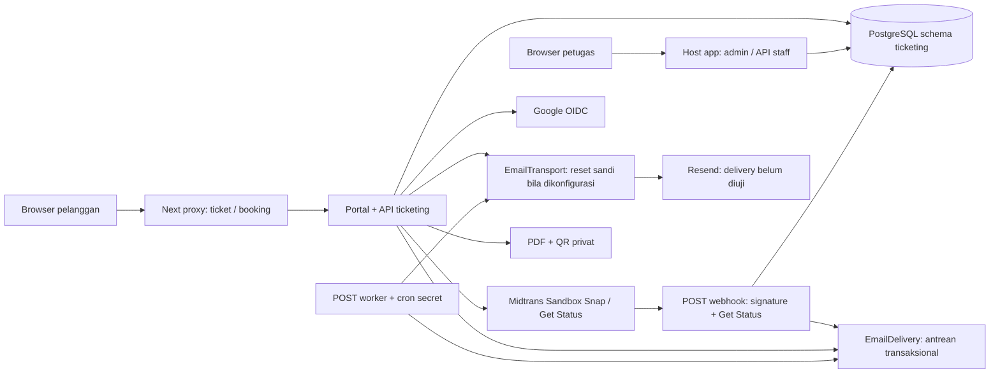
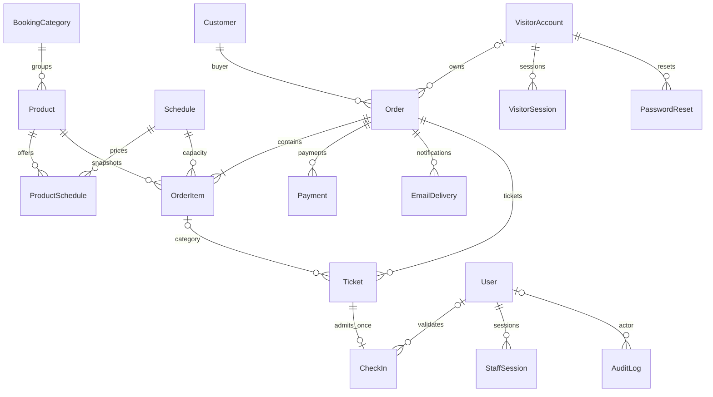
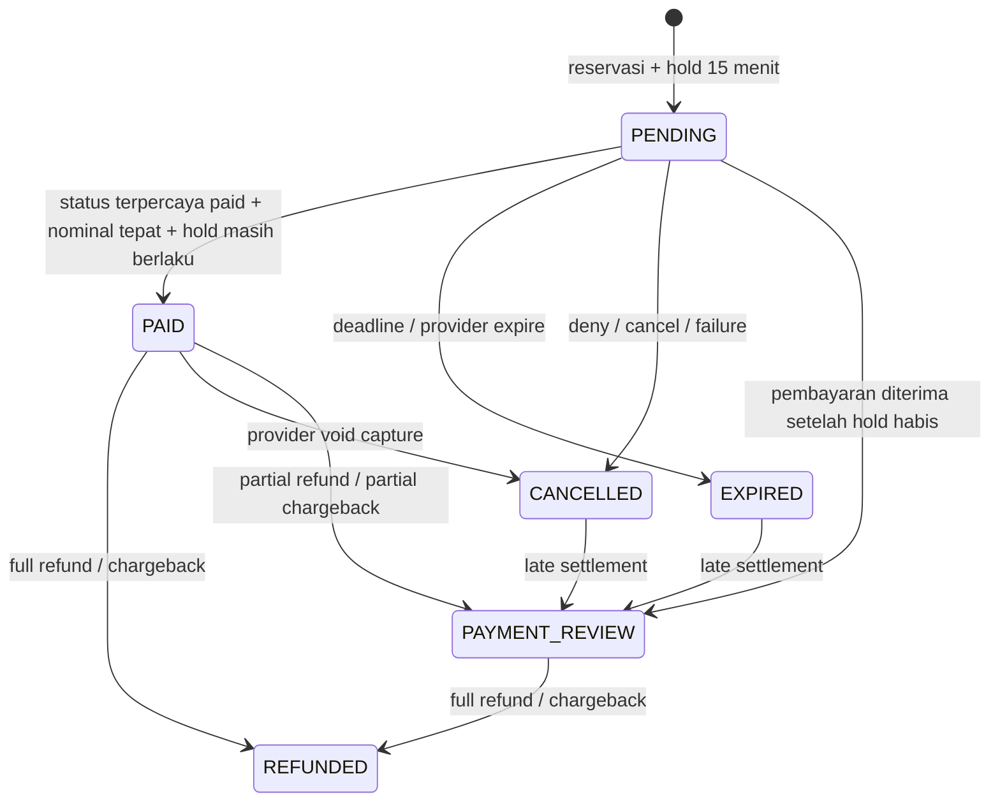

# Desain dan catatan RAD — LUP Booking

Judul penelitian: **Rancang Bangun Sistem Reservasi Tiket Terintegrasi Payment Gateway (Studi Kasus: PT Angklung Udjo Heritage)**.

Dokumen ini mencatat konstruksi dan pengujian yang benar-benar dijalankan. Tidak memuat klaim wawancara, observasi lapangan, UAT pengguna, atau keberhasilan produksi.

## Requirements Planning

Sumber kebutuhan: master prompt dan feature request pengguna pada 13 November 2026, audit source repository, schema/migrasi, serta tes yang tersedia. [Audit awal](audit-2026-11-13.md) menjadi baseline. Aktor: pengunjung, pemilik akun, admin, petugas check-in, dan layanan Midtrans Sandbox.

| ID | Kebutuhan fungsional | Implementasi |
| --- | --- | --- |
| F01 | Pilih kategori dan program yang dikelola admin | BookingCategory → Product; fallback kategori lama untuk produk tanpa relasi |
| F02 | Pilih tanggal, sesi, harga dan kuota yang sah | DateBookingSelector, katalog API, ProductSchedule, format id-ID/Asia-Jakarta |
| F03 | Keranjang dan ringkasan harga | localStorage tervalidasi; scheduleId dan tanggal dipertahankan; harga terbaru dari katalog |
| F04 | Reservasi unik tanpa duplikasi/overbooking | request key hash, advisory lock, row lock Schedule, transaksi Prisma, CHECK kuota |
| F05 | Pembayaran Sandbox terverifikasi | Snap hosted, SHA-512 webhook, GET Status, nominal/order/transaction ID, transisi idempotent |
| F06 | Akun dan ownership | VisitorAccount, VisitorSession; `/account`, profil, bookings, detail, tickets; logout server-side |
| F07 | Google Sign-In | openid-client: authorization code, PKCE, state, nonce, claims; tidak auto-link email lokal |
| F08 | Pemulihan sandi email | Token hash acak, 30 menit, sekali pakai, revokasi semua sesi; transport Resend bila dikonfigurasi |
| F09 | E-ticket PDF dan QR | Ticket terikat OrderItem, token QR acak, PDF per order, endpoint memeriksa pemilik |
| F10 | Check-in sekali pakai | Login petugas individual, role ADMIN/STAFF, lock Order, update Ticket atomik dan unique CheckIn |
| F11 | Admin katalog dan pemantauan | kategori, program/foto/ketentuan, sesi, kuota, harga; pencarian pesanan, status, statistik simulasi, pengelolaan petugas |
| F12 | Domain migration tanpa memutus webhook | booking alias, origin terkonfigurasi, cutover GET/HEAD opt-in; endpoint POST lama tetap langsung |
| F13 | UI/UX redesign booking portal | Premium hero, kategori horizontal, date selector kartu horizontal, login modal dua kolom, dashboard pelanggan, checkout dua kolom, e-ticket dengan QR |
| F14 | Preview deployment (rencana) | Deployment preview belum diverifikasi dalam eksekusi ini; VPS/Nginx existing dipertahankan |
| F15 | Notifikasi email booking opsional | EmailDelivery outbox transaksional, worker berotorisasi, retry/idempotensi; provider Resend belum dikonfigurasi |
| F16 | Riwayat check-in admin | Admin melihat maksimal 100 event dan memfilter referensi pesanan; tidak mengirim qrToken |

| ID | Kebutuhan nonfungsional | Bukti/batas |
| --- | --- | --- |
| N01 | Harga dan kuota ditentukan backend | Tes integrasi database nyata; frontend tidak mengirim unitPrice |
| N02 | Tidak menghapus data lama | Migrasi additive; nullable field untuk data historis; tidak menjalankan migrasi di DB bersama |
| N03 | Kredensial server tetap privat | Environment server; tidak diserialisasi ke props/respons; signature dan QR token tidak muncul di receipt publik |
| N04 | Responsif dan dapat dipakai keyboard | QA Chromium 1440/768/390 px, tombol ≥44 px, focus, live status, dialog native |
| N05 | Bahasa dan waktu konsisten | Bahasa Indonesia, rupiah integer, tanggal Jakarta; Schedule.date adalah tanggal sipil WIB dalam SQL DATE |
| N06 | Kegagalan dapat dipulihkan | Error/retry katalog; expiry; rekonsiliasi status; pembayaran ambigu tidak membuat transaksi kedua |
| N07 | Isolasi hak akses | Cookie host-only, hash token, same-origin mutation; handler tetap memeriksa identitas/role |

Guest checkout tidak diaktifkan: arsitektur yang sudah ada mewajibkan akun. SMS/WhatsApp OTP tidak ditambahkan. Foto memakai path aset LUP lokal, tanpa mengambil aset EIGER. Kategori contoh lama tetap bertanda contoh, tidak dapat dibayar.

## User Design

Pola navigasi kategori, program, tanggal, sesi, dan checkout dipelajari dari https://booking.eigernature.com; tidak menyalin merek atau asetnya. Screenshot referensi yang disebut pengguna tidak tersedia pada pesan ini.

Token aktual portal, yang menimpa token global: forest/cokelat `#442e25`, light `#604536`, cream `#faf6ef`, bamboo `#a56b3e`, Barlow Condensed lokal. Date selector memakai `bg-bamboo` untuk pilihan aktif sehingga mengikuti token portal ini. Homepage publik tidak didesain ulang.

Wireframe aktual:

```text
Desktop detail                      Mobile detail
[Judul program] [Ringkasan]          [Judul / deskripsi]
[Deskripsi & ketentuan DB]           [Program]
[Program]                           [Bulan tahun] [← → Kalender]
[Bulan tahun] [← → Kalender]         [Tanggal → geser horizontal]
[Tanggal → geser horizontal]         [Sesi / harga / kuota]
[Sesi / harga / kuota]               [Jumlah]
[Jumlah]                            [Ringkasan & Tambah keranjang]

Login desktop: [foto budaya + ajakan daftar] [form / Google / email]
Login mobile:  [foto ringkas] [form satu kolom, tutup, Escape, fokus native dialog]
```

Tanggal tanpa sesi tidak mempunyai harga sintetis. Tanggal habis tetap terlihat dan dinonaktifkan. Harga kartu adalah minimum sesi yang masih tersedia pada hari tersebut; harga ringkasan mengikuti sesi terpilih. Pilihan awal adalah hari paling awal dengan kuota, bukan hari paling awal dalam daftar.

## Construction

Arsitektur mempertahankan satu aplikasi Next.js/Payload dan satu PostgreSQL dengan pemisahan schema `ticketing`. Tidak mengganti ORM, provider payment, atau database. Diagram UML tersedia sebagai sumber PlantUML di [diagrams](diagrams/); ERD di bawah mengikuti schema Prisma.





## Spesifikasi database

Source of truth kolom/constraint: `prisma/schema.prisma` dan SQL migrasi; tabel ringkas ini tidak menggantikan spesifikasi tersebut.

| Entitas | Kunci dan aturan |
| --- | --- |
| BookingCategory | id PK, slug unique; active default false; metadata kategori di DB |
| Product | id PK, slug unique, harga integer; optional kategori/foto/ketentuan; type lama dipertahankan |
| ProductSchedule | PK gabungan productId/scheduleId; FK restrict; harga >0 dan ≤1 miliar; active; update diserialisasi dengan checkout |
| Schedule | unique date/session; kapasitas ≥ reserved+sold melalui constraint; tanggal/jam sesi yang telah terpakai tidak dapat dipindah |
| Customer | email unique; profil historis tidak diambil alih pemesan lain |
| Order | orderNumber unique acak; requestKeyHash unique; visitorId nullable untuk histori; total & expiry; status enum |
| OrderItem | snapshot nama/harga/jumlah/lineTotal; FK produk/jadwal/order |
| Payment | provider/providerPaymentId unique; jumlah, status, hosted URL dan checkout claim |
| Ticket | code unique acak 96 bit; qrToken unique acak 256 bit; optional orderItemId untuk kompatibilitas histori |
| CheckIn | ticketId unique; waktu, petugas, sumber QR/manual simulasi |
| EmailDelivery | id PK; eventKey unique; orderId FK RESTRICT; kind/state/attempt CHECK; index state/nextAttemptAt dan orderId; claimId/lease, retry, providerMessageId |
| VisitorAccount | email unique; Google subject unique nullable; passwordHash nullable untuk Google; emailVerifiedAt |
| VisitorSession | tokenHash unique; expiry; FK akun |
| PasswordReset | tokenHash PK; expiry 30 menit; FK akun; dihapus atomik saat dipakai |
| OAuthAttempt | stateHash PK; verifier/nonce server-side; expiry 10 menit; sekali pakai |
| User / StaffSession | enum ADMIN/STAFF; active; scrypt password; tokenHash PK; sesi 8 jam |
| AuditLog / RateLimit | riwayat aksi, entity index; counter database atomik dan expiry |

Sesi dan jadwal memakai kuota bersama lintas produk pada Schedule yang sama. ProductSchedule membatasi produk yang boleh dijual dan harganya, bukan membuat kumpulan kapasitas kedua. Produk tanpa satu pun konfigurasi pasangan memakai jadwal/harga dasar lama. Setelah pasangan pertama dibuat, hanya pasangan aktif yang dijual. Admin diberi penjelasan ini di UI.

## Model status pembayaran



Webhook pending/replay tidak mengembalikan order paid menjadi pending. Tiket hanya terbit saat transisi PENDING→PAID yang sah. Late payment tidak mengambil kapasitas pelanggan lain. Refund/void menonaktifkan tiket issued; tiket used tetap menyimpan bukti check-in. Kuota sold tidak dibuka otomatis setelah refund. PaymentStatus `FAILED` digunakan untuk penolakan/gagal/cancel; OrderStatus-nya `CANCELLED`. Partial refund memerlukan peninjauan manusia, belum mempunyai otomasi refund dari panel.

## Iterasi yang dilakukan

| Iterasi | Temuan/tindakan | Verifikasi |
| --- | --- | --- |
| 1 | Audit stack, auth, payment, routing, schema; branch khusus | Baseline 32 tes PASS, TypeScript/lint PASS |
| 2 | ProductSchedule + selector + harga checkout + admin kuota | 36 tes PASS |
| 3 | Item-bound ticket, PDF/QR, staff sessions, check-in, reset, OIDC | Tes database ditambah; satu kesalahan regex redirect ditemukan dan diperbaiki |
| 4 | Kategori/foto/ketentuan DB dan alias domain, cutover guard | 44 tes PASS, termasuk constraints dan replay |
| 5 | QA browser tiga viewport; inspeksi screenshot menemukan overflow setelah keyboard | Perbaikan grid dan scroll lokal; assertion pasca interaksi ditambahkan; hasil final di test-report |
| 6 | Audit dependency menemukan advisory kritis dan build/QA berebut generated types | Patch dependency; tsconfig QA terpisah; final check dicatat tanpa menghapus kegagalan awal dari catatan |
| 7 | UI/UX redesign Phase 3: desain sistem token, homepage premium, date selector kartu horizontal, login modal dua kolom, dashboard pelanggan, checkout dua kolom, halaman e-ticket | 44/44 tes integrasi, 25/25 tes browser, TypeScript/lint/build lulus; semua uji dijalankan pada disposable local DB |
| 8 | Run pembayaran nyata Snap BNI, webhook HTTPS asli melalui tunnel terbatas, retry 503, replay, cancel/expire, PDF dan concurrent check-in | 15/15 pemeriksaan; pembayaran Sandbox sungguhan, bukan status stub |
| 9 | Service email opsional + outbox durable, history check-in admin, update dependency terarah | Integrasi 50/50, browser 32/32, kompatibilitas 3/3; critical/high 0/0; provider email nyata belum tersedia |
| 10 | Pemilih tanggal menyembunyikan hari tanpa jadwal dan arrow memakai pilihan aktif sebagai batas | Semua tanggal backend ditampilkan dengan disabled state; arrow mengikuti scroll aktual; desktop/tablet/mobile dan keyboard PASS |

## Cutover

[Runbook domain](domain-migration.md) mencatat DNS, Nginx/TLS, OAuth origins/callback dan Midtrans notification yang harus diverifikasi. Belum ada push/deploy/migrasi database bersama dalam pekerjaan ini. Cookie host-only membutuhkan login ulang pada domain baru; akun dan reservasi tetap pada database yang sama.

Verifikasi terbaru: [Phase 2 completion](phase-2-completion-2026-11-14.md), [E2E20](phase-2/e2e-matrix.md), [migration copy](phase-2/migration-safety.md). DNS A tersedia, HTTPS booking belum berhasil. Google baru authorization page; email delivery, kamera fisik dan UAT belum dilakukan. Cutover tetap rencana; backup/restore diuji pada populated synthetic copy, belum clone produksi.

Hasil tes, screenshot dan bukti yang bisa direproduksi: [test-report](test-report.md), [evidence](evidence/). UAT belum dilakukan oleh perwakilan PT Angklung Udjo Heritage; checklist bukan bukti penerimaan.

## Referensi teknis

- Dokumentasi versi Next.js terpasang: `node_modules/next/dist/docs/` (Route Handlers, Proxy, distDir, TypeScript config).
- Midtrans: https://docs.midtrans.com/docs/https-notification-webhooks dan https://docs.midtrans.com/reference/backend-integration.
- Google OIDC: https://developers.google.com/identity/openid-connect/openid-connect.
- openid-client: https://github.com/panva/openid-client.
- PDFKit: https://pdfkit.org/docs/getting_started.html; QR: https://github.com/soldair/node-qrcode.
- UML 2.5.1 specification: https://www.omg.org/spec/UML/2.5.1 (notasi UML); sintaks sumber diagram menggunakan PlantUML.

Referensi ini adalah dokumentasi teknis, bukan hasil wawancara atau sumber akademik RAD. Bibliografi metodologi RAD penelitian masih perlu dilengkapi dari sumber akademik yang benar-benar dibaca peneliti.
